<div align="center">

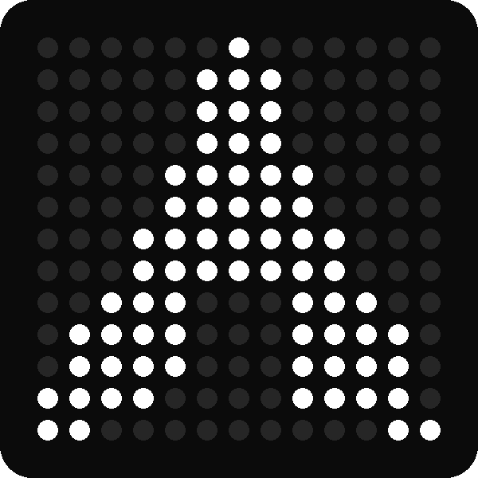

# Nought

**The Nothing phone's desktop, on Linux.**


[Screenshots](#screenshots) · [Pages](#pages) · [Install](#install)

</div>

Hyprland + Quickshell, built to the letter of **Nothing OS**: matte black,
concrete grey, red `#d71921`, tight radii, the Ndot face, and a Glyph
Matrix that actually runs toys instead of sitting there as a picture of
one.

> [!NOTE]
> Unofficial. Not affiliated with Nothing Technology Limited. Written
> for **Arch / EndeavourOS**, **Hyprland ≥ 0.56** (Lua config) and
> **Quickshell ≥ 0.3**.

## Screenshots

| Desktop | Nothing Launcher |
|:---:|:---:|
| 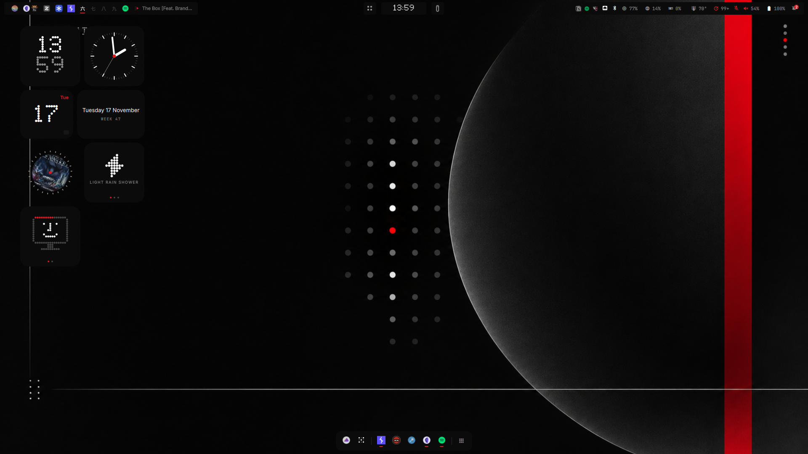 | 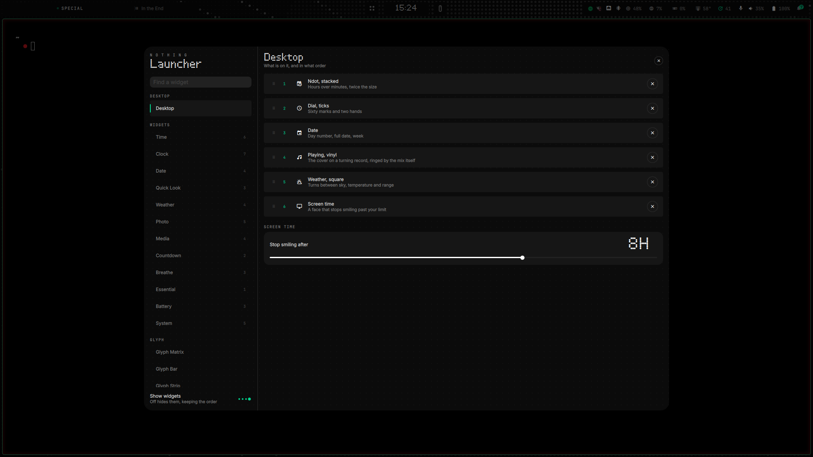 |
| **Glyph Matrix** | **Glyph Bar** |
| 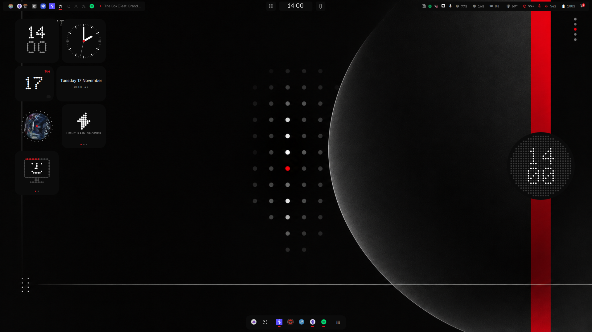 | 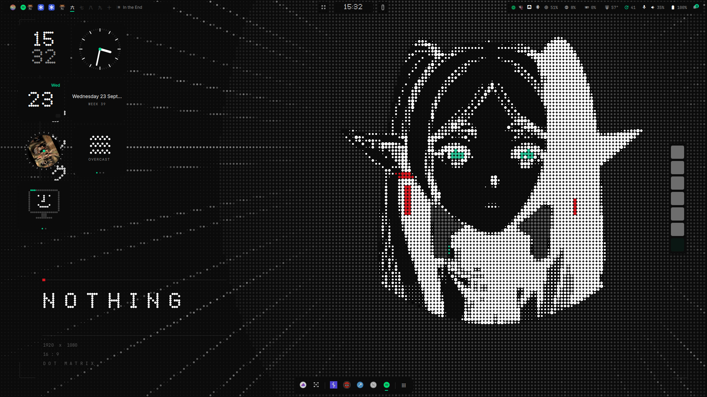 |
| **Glyph Strip** | **Glyph, in the launcher** |
| 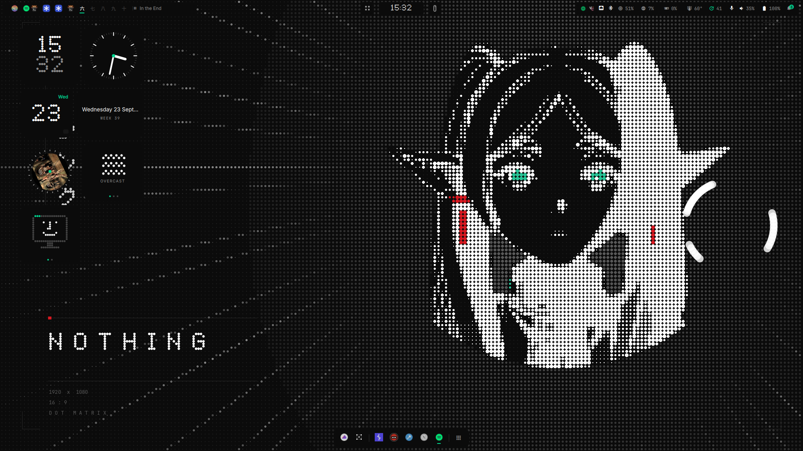 | 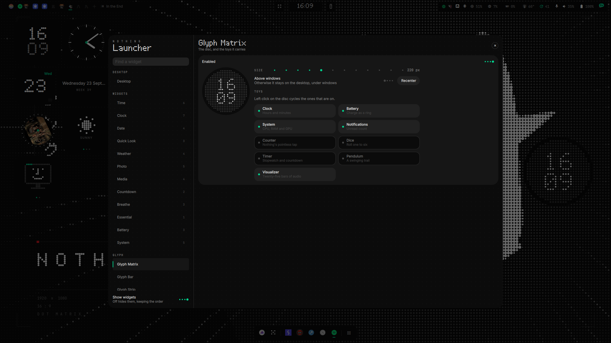 |
| **Control centre** | **Settings** |
| 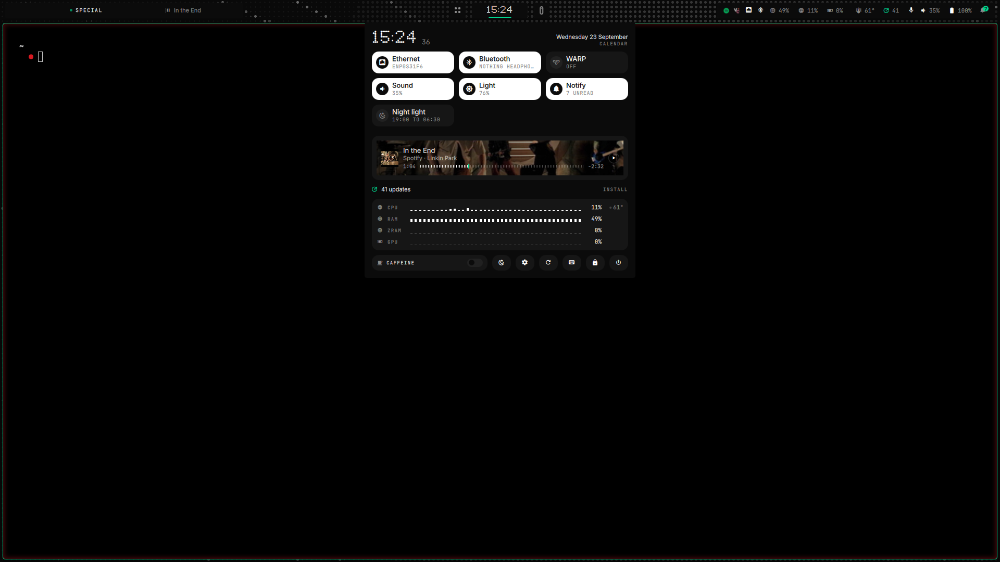 | 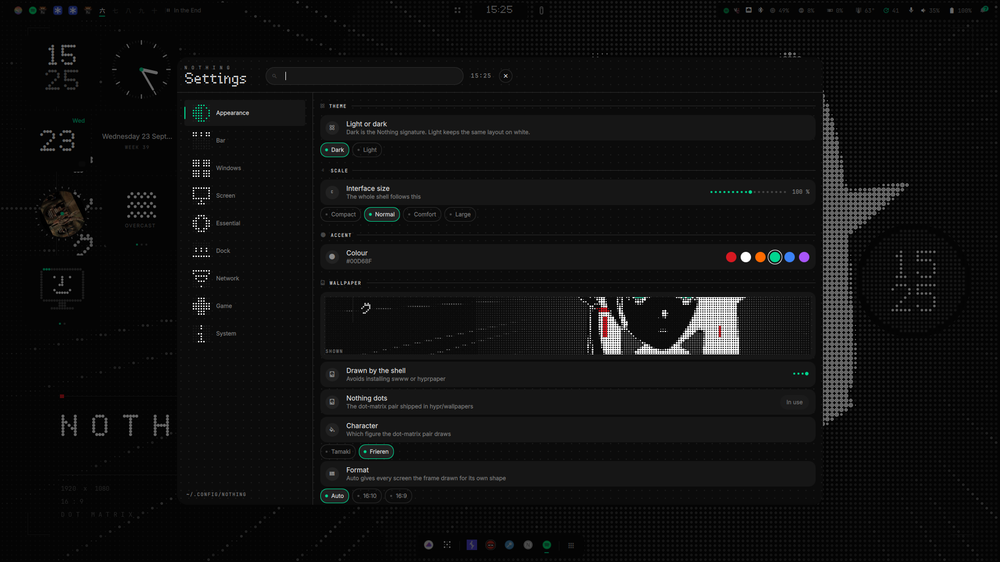 |
| **Settings, System** | **Essential Search** |
| 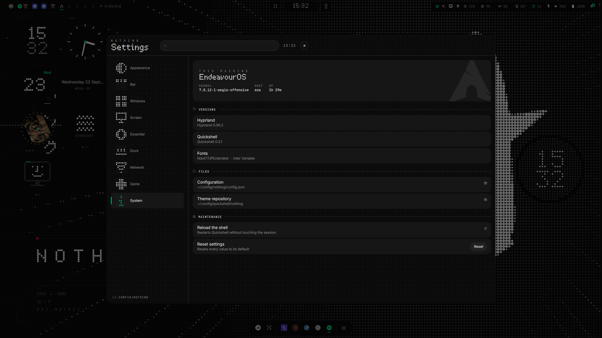 | 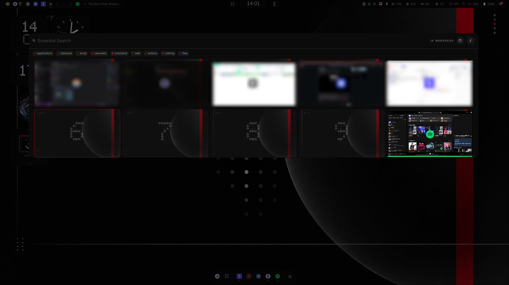 |
| **Essential Space + Key** | **Essential Apps** |
| 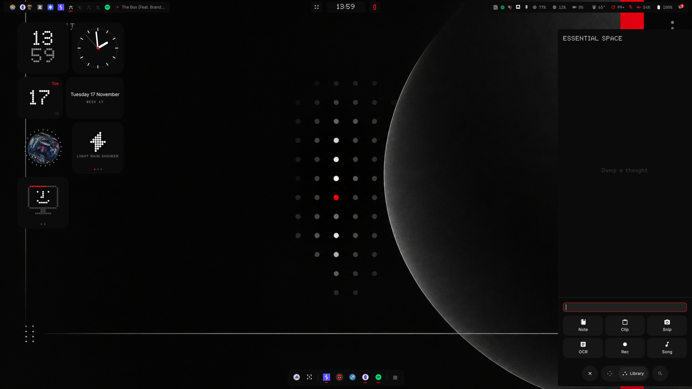 | 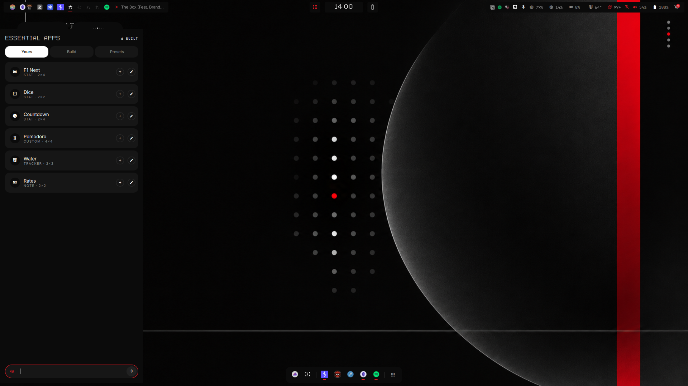 |
| **Game bar** | **Dolphin** |
| 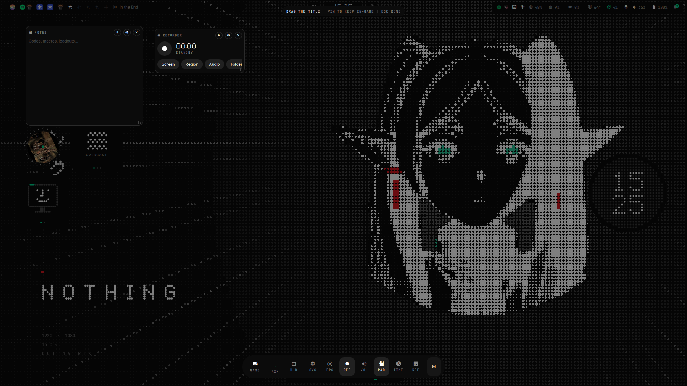 | 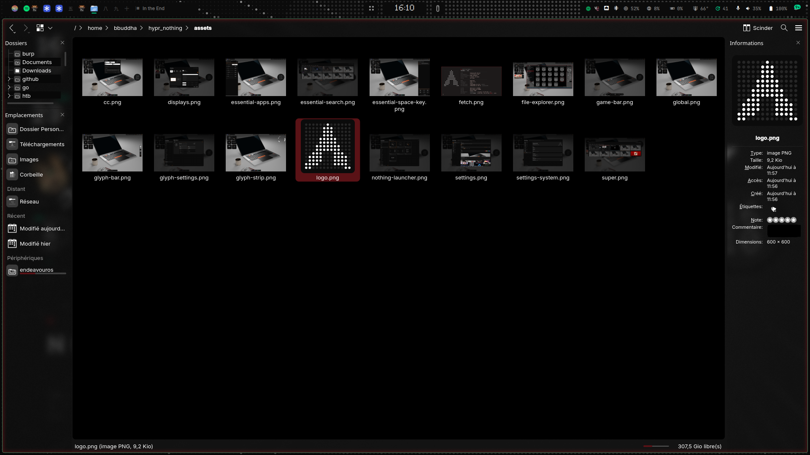 |
| **Displays** | **fastfetch** |
| 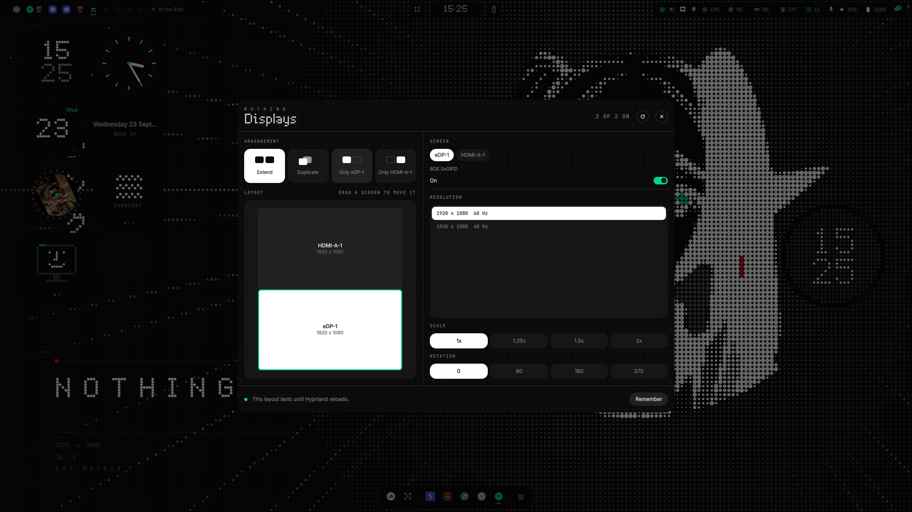 | 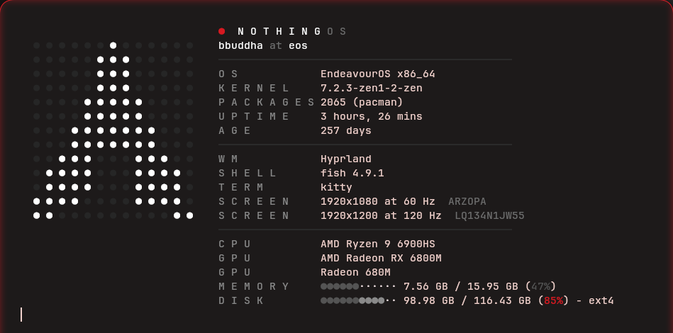 |

## Pages

Every surface below is Quickshell, not a picture of a feature - the
Glyph Matrix really lights up, Essential Apps really builds a widget
from what you type.

| Page | Opens with | What it does |
|---|---|---|
| **Launcher** | `SUPER` | Search on top, 10-workspace overview under it. `#` lists every Nothing app and surface |
| **Nothing Launcher** | `SUPER+ALT+L`, or the dot button on the dock | Where widgets and the Glyph are chosen. Every preview is the real widget at its real size |
| **Essential Space** | `SUPER+A` | The phone's capture vault - clips, screenshots, voice notes, song recognition - searchable, optionally enriched by AI |
| **Essential Apps** | `SUPER+ALT+A`, or the dot grid left of the clock | A conversation that builds a homescreen widget. Describe it, iterate, pin it. 2×2, 2×4 and 4×4 |
| **Glyph Interface** | `SUPER+SHIFT+G` cycles the surface | Matrix (489-dot disc, running toys), Bar (six segments + camera light), Strip (three arcs) - one lit at a time, nine rhythms ship |
| **Control centre** | `SUPER+N` | Wi‑Fi, Bluetooth, sound, brightness, night light, caffeine, WARP, the usual |
| **Notifications** | `SUPER+B` | History + an **Open message** action for Vesktop / Discord |
| **Settings** | `SUPER+I` | Everything below, plus live previews of the bar and control centre you're editing |
| **Displays** | `SUPER+P` | Arrangement, resolution, refresh, scale, rotation per screen, dragged on a map. Undoes itself after 15 seconds if a mode leaves you on a black screen |
| **Game bar** | `SUPER+G` | Overlay widgets you pin over a game |
| **Screenshots** | `SUPER+SHIFT+S` region · `SUPER+SHIFT+X` OCR | Click a window, drag a rect, or click empty for the output. OCR and **Translate** (local, then your AI backend) live in the same panel |
| **Wallpaper picker** | `SUPER+SHIFT+T` | Four shipped defaults (Nothing or manga, dark or light), or your own picture - per screen, crop or fit |
| **Clipboard** | `SUPER+V` | History via cliphist. A copy that's a hex colour shows the real swatch; a bare URL gets a link icon - still copies on click either way |
| **Processes** | `CTRL+SHIFT+Esc` | What's using CPU/memory, end a frozen app |
| **Session / Lock** | `SUPER+Esc` / `SUPER+L` | Power menu / lock screen, drawn by the shell itself |

Apps (terminal, browser, editor, file manager) are detected among what's
installed, not hardcoded.

### Glyph Interface

Three surfaces, one lit at a time:

- **Matrix** - the 489-dot disc, running toys (clock, battery, dice, cava…)
- **Bar** - six segments and the camera light, Phone (4a)
- **Strip** - three arcs around where the camera would be, Phone (3a)

The Bar and the Strip are dark until something happens. Which events may
light them, and the rhythm each one plays, is yours to set: nine rhythms
ship, and you can tap your own on the pads.

### AI, two ways

One setting (**Settings > Essential > Mind**) drives Essential Apps'
conversation, Essential Search's `Ask` (`SUPER`, then type a question),
and the screenshot panel's **Translate** action.

- **Gemini** - a free key from Google AI Studio
- **Ollama** - `ollama run llama3.2` or any model you already have, fully
  local, nothing leaves the machine

Stub (the default) turns all three off rather than silently failing.

### Screen translation

The screenshot panel's **Translate** action: region select, then
Translate. OCRs the crop locally (tesseract), then sends the text
through whichever Mind backend is set above. Target language in
**Settings > Essential**, English by default. Also reachable without
the panel - the `screenshot` IPC target's `translate` function, for a
keybind of your own in `~/.config/hypr/custom.lua`.

### Three window layouts

In **Settings > Interface > Windows**:

- **tiling** - Hyprland's dwindle, the default
- **scrolling** - the niri-style tape where a new window arrives at its
  own width instead of shrinking everything else
- **essential** - one window in front of you, every other one parked as
  a sliver down one side; the phone's Essential Space, applied to windows

No plugin for either of the last two: scrolling has been in Hyprland
since 0.54, and essential is 180 lines of Lua in `hypr/hyprland/layouts/`.
`SUPER+,` and `SUPER+.` mean narrower and wider in all three.

### Nothing is hardcoded

The bar's three islands and the control centre are both built from a
registry: 19 bar elements across left, centre and right; 14 control
centre tiles, 8 footer buttons, 5 blocks, 2 to 4 tiles per row. **Settings
> Interface** edits both, with a live preview of each.

### Desktop widgets

46 of them in 12 families: dot-matrix and dial clocks, date and calendar,
Quick Look, weather, photos, media, a countdown on any of Nothing's
twelve shapes, breathing exercises, battery, network, screen time, world
clock. A different look is a separate widget, never a setting, so
nothing changes size underneath you.

### Spotify, in the same palette

No green anywhere - Ndot on the page titles and the track name, hairlines
instead of gaps, and the play button in whatever accent the shell is set
to. Turned on from **Settings > Appearance > Spotify**, which handles the
one thing that needs root (Spotify is patched in place) through the
shell's own polkit prompt, and notices when you change your accent.
`./scripts/apply-spicetify.sh` does the same from a terminal.

### Wallpapers

Four ship in `hypr/wallpapers/` - Nothing or manga, each dark or light.

| Nothing, dark | Nothing, light |
|:---:|:---:|
| 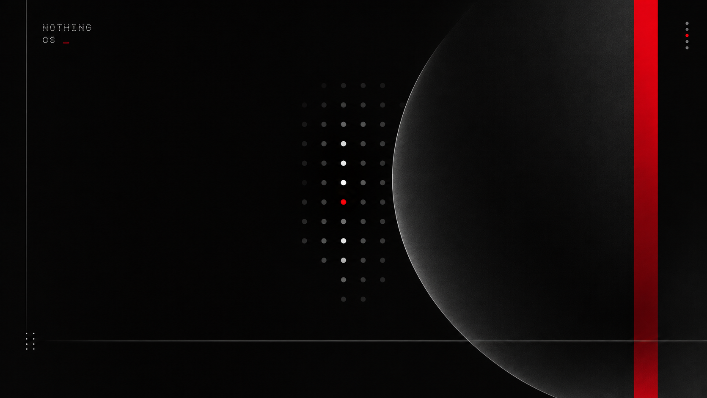 | 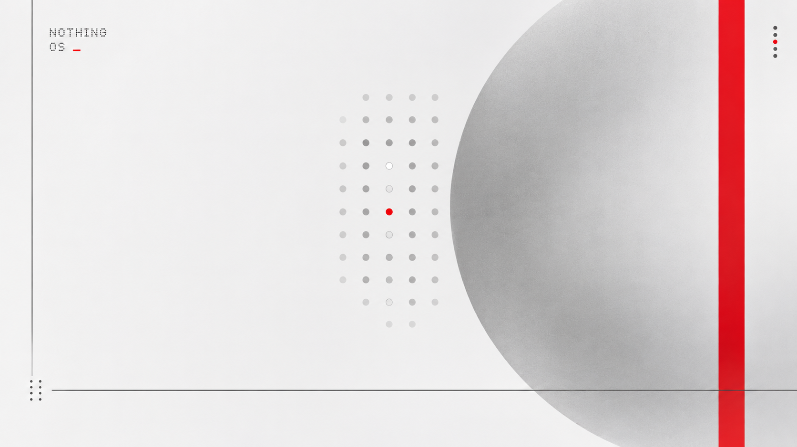 |
| **Manga, dark** | **Manga, light** |
| 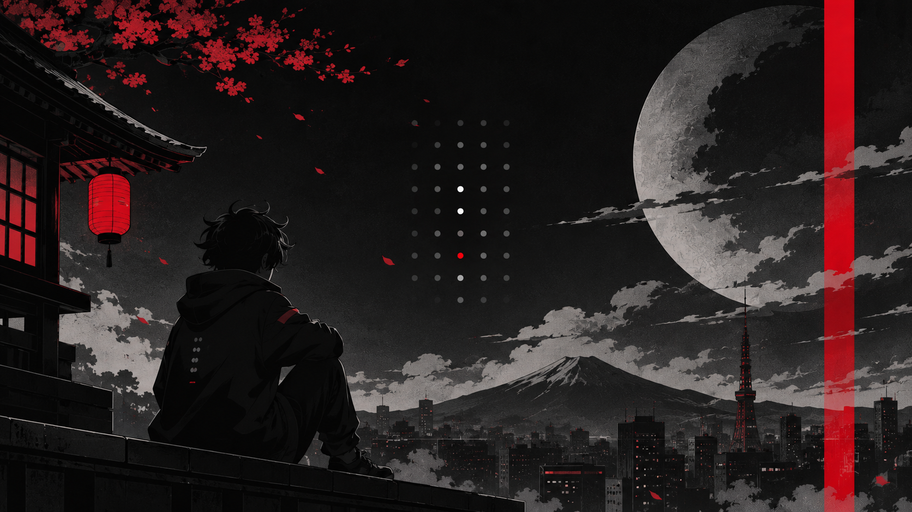 | 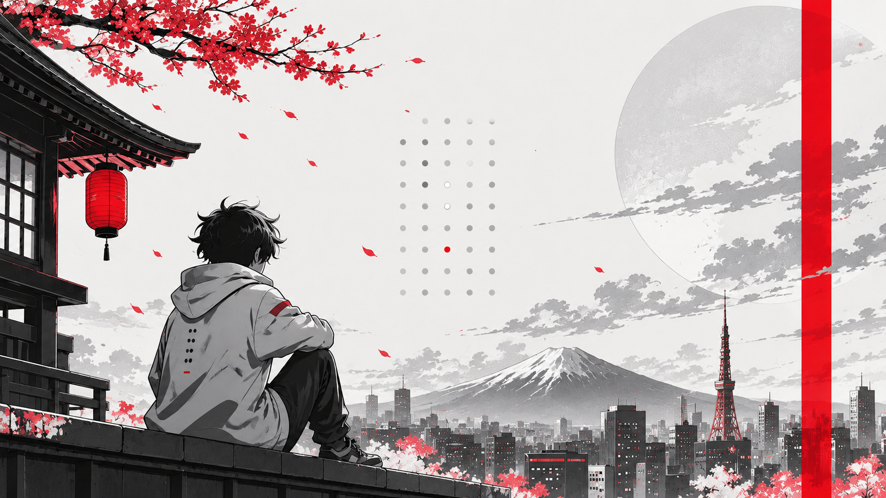 |

`scripts/dot-wallpaper.py` makes more of them from any picture: black
ground, one red kept from the source, manga concentration lines, and a
vertical Japanese column set in Nothing's own dot face. What it lights is
the ink, not the luminance, which is what makes a drawing survive being
turned into dots.

`scripts/glass-wallpaper.py` runs a picture through Nothing's other
wallpaper style instead: fluted glass, vertical ribs each shifted and
lensed on their own, a highlight down the centre of each one and a
groove at its seam. Works best on an actual photo - fine detail (a
dot-matrix wallpaper, for one) turns to noise once it is sliced this
finely.

### A few more things

- **fastfetch** in the same language as the rest: tracked capitals, one
  red, and a dot-matrix logo rasterised from the real vector rather than
  drawn by hand. `scripts/fetch-logo.sh` picks between the Arch mark, the
  Nothing mark and your own PNG; `scripts/fetch-logo.sh alternate arch
  tamaki` shows a different one each run
- Optional **WARP** (1.1.1.1) tile in the control centre if `warp-cli` is
  installed - `./install` offers the AUR package `cloudflare-warp-bin`
- On an Asus ROG machine, `./install` offers the three asus-linux tools.
  It never touches your kernel

## What's inside

| | |
|---|---|
| **Compositor** | [Hyprland](https://hyprland.org) ≥ 0.56, Lua config |
| **Shell** | [Quickshell](https://quickshell.outfoxxed.me/) - every panel above, in QML |
| **Terminal / shell** | [kitty](https://sw.kovidgoyal.net/kitty/) · [fish](https://fishshell.com) + starship |
| **Player / file manager** | [mpv](https://mpv.io) · Dolphin, themed to match, file pickers through xdg-desktop-portal |
| **Lock / idle** | the shell's own lock screen, on ext-session-lock · hypridle |
| **Login** | SDDM, session named **Nothing**, astronaut greeter |
| **AI (optional)** | Gemini, or Ollama fully local - one setting drives both |

Settings live in `~/.config/nothing/config.json`.

## Install

```bash
git clone https://github.com/0xbbuddha/Nought.git ~/hypr_nothing
cd ~/hypr_nothing
./install
```

That writes the rice into **your** config dirs as **copies** (rsync/cp,
no symlinks). Whatever was already there is moved to `*.bak-<date>`.

> [!WARNING]
> Needs `sudo` for packages and the session file. Do not run the script
> itself as root.

| Flag | What it does |
|---|---|
| *(none)* | packages + `~/.config` + SDDM |
| `--deps` | packages only |
| `--files` | `~/.config` + theme, skip pacman |
| `--uninstall` | restore the backups (not packages) |
| `--noconfirm` | no prompts |

After a `git pull`, run `./install --files` again to refresh the copies -
or let the shell do it: **Settings > System > Maintenance > Update**
checks GitHub when you open that page, and offers a one-click apply
once you're behind.

Without SDDM, from a TTY:

```bash
./scripts/nothing-session.sh   # SUPER+SHIFT+M leaves it
```

### Nested (dev)

```bash
./scripts/run-nested.sh
```

The host compositor eats `SUPER`. Optional passthrough: source
`hypr/passthrough.lua` in the host config, then `SUPER+ALT+P`.

### Shell only

```bash
./scripts/run-shell.sh          # overlay on the current session
./scripts/run-shell.sh --solo   # pause an illogical-impulse shell
```

## Shortcuts

Everything not already a page above:

| Keys | Action |
|---|---|
| `SUPER+Enter` / `SUPER+T` | terminal |
| `SUPER+E` | file manager |
| `SUPER+W` | browser |
| `SUPER+D` / `SUPER+F` | maximise / fullscreen |
| `SUPER+ALT+B` | night light on/off |
| `SUPER+ALT+I` | caffeine: keep the screen awake |
| `SUPER+ALT+W` | next wallpaper from the folder |
| `SUPER+SHIFT+R` | record a region |
| `CTRL+SHIFT+SUPER+Left/Right` | send the current workspace to the other monitor, and follow it there |
| `SUPER+.` | emoji |

Stock binds: `hypr/hyprland/keybinds.lua`. Personal ones go in
`~/.config/hypr/custom.lua` (created on install). Throwaway tests:
`~/.config/hypr/local.lua`.

## Fonts

```bash
yay -S ttf-nothing-font-git    # Ndot77 + Inter - pulled by ./install
```

Without that package the UI still runs, on system fonts.

## Performance

> [!NOTE]
> Measured in PSS, not RSS: RSS counts each shared library in full
> inside every process that maps it, which is the wrong metric here.

Measured on an AMD Ryzen 9 6900HS:

| Process | RAM |
|:---|:---:|
| Hyprland | ~118 MB |
| Quickshell (the rice itself) | ~470 MB |
| hypridle | ~1 MB |

Call it 600 MB total. Quickshell's own CPU sits at 2–5% idle, and climbs
to 20–25% while a widget is actively animating (media playing, the vinyl
disc turning, its bars moving) - bar, dock, desktop widgets, Glyph Matrix
and the wallpaper reveal all running either way. Hyprland's CPU load is
left out: it's whatever the windows open on top of it are doing, not the
config.

## Uninstall

```bash
./install --uninstall
```

Packages are left installed. App theme revert:

```bash
./scripts/apply-app-theme.sh --revert
./scripts/apply-spicetify.sh --revert
```

## Credits

- [Nothing OS](https://nothing.tech) for the language (again: unofficial)
- [end-4 / illogical-impulse](https://github.com/end-4/dots-hyprland) -
  that was my daily rice. I got used to a handful of its behaviours, and
  those habits steered the direction this took
- [Quickshell](https://quickshell.outfoxxed.me/)

Internals (file map, Hyprland Lua notes): [docs/internals.md](docs/internals.md).

## Licence

MIT - see [LICENSE](LICENSE).
